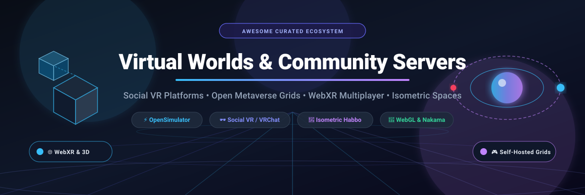

# 🌐 Awesome Virtual Worlds & Community Servers 🚀

  <strong>Curated Directory of Top SaaS Platforms & Open-Source Community Servers for the Open Metaverse, Social VR, WebXR Multiplayer Rooms, and Isometric Virtual Spaces 🌟 Star if you like it! 🌟</strong>

*Last updated: November 2026*

---

## 📑 Table of Contents
- [📌 Overview & SEO Highlights](#-overview--seo-highlights)
- [📊 Sector Overview & Market Dynamics](#-sector-overview--market-dynamics)
- [🏢 SaaS & Hosted Virtual World Platforms](#-saas--hosted-virtual-world-platforms)
- [💻 Open-Source Community Servers & Engines](#-open-source-community-servers--engines)
- [🤝 How to Contribute](#-how-to-contribute)
- [💖 Support & Sponsorship](#-support--sponsorship)
- [⭐ Star History](#-star-history)
- [⚖️ Disclaimer](#️-disclaimer)

---

## 📌 Overview & SEO Highlights

Welcome to the definitive developer and creator index for **virtual worlds**, **community servers**, **open metaverse grids**, **social VR engines**, and **WebXR multiplayer environments**. Whether you are architecting a self-hosted **OpenSimulator** or **Luanti (Minetest)** grid, hosting a retro Habbo-style isometric social hotel using **Habblaud** or **Nitro**, deploying a browser-based 3D workspace with **Mozilla Hubs** and **Hyperfy**, or scaling spatial voice and avatar networking via **Nakama**, **Colyseus**, or **LiveKit**, this guide organizes the leading commercial SaaS products and open-source GitHub repositories.

### 🔍 Key Discovery Keywords & Topics
`virtual-worlds` • `metaverse` • `social-vr` • `webxr` • `opensimulator` • `luanti` • `minetest` • `vrchat` • `roblox-studio` • `second-life` • `threejs` • `babylonjs` • `godot-engine` • `vrm` • `nakama` • `colyseus` • `workadventure` • `habbo-hotel` • `spatial-audio` • `multiplayer-server`

---

## 📊 Sector Overview & Market Dynamics

The global **Virtual Worlds & Metaverse Software/Platform Sector** was valued at approximately **$92.4 Billion in 2024** and is projected to surpass **$500+ Billion by 2030–2032**, expanding at an aggressive compound annual growth rate (CAGR) of **38%–42%**. Growth is propelled by enterprise virtual collaboration, digital twin environments, user-generated content (UGC) creator economies, and high-fidelity WebXR/Social VR hardware adoption.

From an industry structure perspective, the market is **moderately fragmented and bifurcated**:
1. **Tier-1 Hyper-Scale Gaming & Consumer Sandboxes**: Highly concentrated and dominated by winner-take-most UGC ecosystems like **Roblox** ($31.2B+ market cap) and leading social VR hubs like **VRChat**, which control massive consumer network effects, proprietary creator royalties, and real-time social engagement.
2. **Enterprise, WebXR, & Decentralized Community Servers**: Strongly fragmented across open-source engines (**Luanti**, **OpenSimulator**, **Godot Engine**, **Hyperfy**, **Mozilla Hubs**) and modular real-time multiplayer backends (**Nakama**, **Colyseus**, **LiveKit**). In this layer, independent developers, universities, self-hosted communities, and privacy-conscious enterprises favor open standards (glTF, VRM, WebSockets, WebRTC) over closed commercial walled gardens.

---

## 🏢 SaaS & Hosted Virtual World Platforms

The table below catalogs premier hosted SaaS virtual worlds, sorted descending by company scale (**Market Capitalization / Valuation / Annual Revenue**), detailing exact commercial starting tier pricing and specific free-tier allocations.

| Platform / Company | Scale (Valuation / Revenue) | Starting Pricing (Paid Tiers) | Free Tier Limits / Free Trial Days & Caps | Primary Focus & Highlights |
| :--- | :--- | :--- | :--- | :--- |
| **[Roblox](https://roblox.com)** | **$31.2B Market Cap** (~$3.6B Annual Revenue) | **$4.99/mo** (Roblox Premium 450 Robux/mo; higher tiers at $9.99/mo for 1,000 Robux and $19.99/mo for 2,200 Robux) | **Free forever plan**: Unlimited gameplay and world exploration; free creation and hosting in Roblox Studio with 100 concurrent players per server; 10% marketplace revenue share without Premium; no paid subscription required to build. | Massive global UGC gaming platform, cloud server scaling, Luau scripting, and creator monetization economy. |
| **[Rec Room](https://recroom.com)** | **$3.5B Valuation** (Private peak; ~$55M Annual Revenue) | **$7.99/mo** (Rec Room Plus / RR+; grants 6,000 monthly tokens, Maker Pen creator tools, and real-money token monetization payout access) | **Free forever plan**: Unlimited access to public and private rooms across VR, iOS, Android, PC, and consoles; free custom room building using in-game Maker Pen and Circuits V2 visual logic; real-cash creator payouts locked behind RR+. | Cross-platform social VR sandbox and multiplayer mini-game hub with collaborative Maker Pen room authoring. |
| **[IMVU](https://imvu.com)** (Together Labs) | **~$1.2B Valuation** (~$75M Annual Revenue) | **$4.99/mo** (VIP Gold tier; VIP Platinum at $9.99/mo; VIP Diamond at $19.99/mo for enhanced room creation) | **Free forever plan**: 1 free personal room; basic avatar customization and catalog shopping with earnable promotional credits; capped at 10 active chat friends in room without VIP host privileges. | 3D avatar social chat network, extensive fashion and room catalog, and legacy virtual community hangout. |
| **[VRChat](https://vrchat.com)** | **$1.0B+ Valuation** (~$60M Annual Revenue) | **$9.99/mo** (or $99.99/yr for VRChat Plus; adds custom user icons, 100 favorite avatar slots, and supporter badges) | **Free forever plan**: Full unlimited VR/desktop access to public/private community worlds, full-body tracking, and world uploading via Unity SDK; capped at 25 favorite avatars and 300 friend slots (no custom invite photos). | Flagship social VR world, Unity Udon/UdonSharp visual scripting, live music events, and avatar creator communities. |
| **[The Sandbox](https://sandbox.game)** (Animoca Brands) | **$1.0B+ Valuation** (~$35M Annual Revenue) | **$30.00/mo** (Creator Land Rent / Event Season Passes; LAND parcels starting at ~0.35 ETH / ~$900 one-time secondary market) | **Free forever plan**: Unlimited access to VoxEdit voxel modeling tool and The Sandbox Game Maker; free access to public social hubs and community experiences; publishing public experiences requires owning or renting LAND. | Voxel-based virtual world and decentralized gaming universe with VoxEdit asset design and Game Maker mechanics. |
| **[Decentraland](https://decentraland.org)** | **~$800M Market Cap** (~$15M Annual DAO Inflows) | **$10.00 one-time** (~100 MANA for Decentraland Name registration; Worlds hosting server subscription starts at **$15.00/mo** / 100 MANA for dedicated server storage) | **Free forever plan**: Free browser and desktop client access as guest or web3 wallet; free local SDK development and CLI preview; free access to 1 personal DCL World parcel capped at 100MB asset storage and 100 concurrent visitors. | Decentralized DAO-governed WebGL virtual world supporting interactive TypeScript SDK scenes and community-owned parcels. |
| **[Second Life](https://secondlife.com)** (Linden Lab) | **$600M Est. Valuation** (~$65M Annual Revenue) | **$11.99/mo** (Premium membership billed monthly, or $8.25/mo billed annually; Premium Plus at $29.99/mo with 2,048 m² tier bonus) | **Free forever plan**: Standard free account allows full world exploration, public sandbox building, marketplace buying, and group chat; capped at 0 Mainland tier allowance (cannot own Linden mainland real estate without Premium). | The foundational 3D virtual world featuring user-owned real estate, Linden Scripting Language (LSL), and an open economy. |
| **[Spatial.io](https://spatial.io)** | **~$300M Valuation** (~$12M Annual Revenue) | **$25.00/mo** (Spatial Creator / Pro tier billed annually at $20/mo; unlocks custom domain branding, premium avatar assets, and up to 100 concurrent room attendees) | **Free forever plan**: Unlimited public and private virtual spaces; up to 50 concurrent users per space; access to Unity Creator Toolkit, browser/WebXR/mobile clients, and standard spatial audio. | WebXR-first and Unity-driven 3D social hub for interactive art exhibitions, virtual conferences, and branded metaverse experiences. |
| **[Somnium Space](https://somniumspace.com)** | **~$120M Market Cap / Valuation** (~$5M Annual Revenue) | **$15.00/mo** (Somnium World Server hosting for custom unity spaces; Land parcel ownership required for permanent world anchors) | **Free forever plan**: Free download of Somnium PCVR and Web client; free world exploration, avatar live chat, and event participation; building persistent public world parcels requires virtual parcel ownership. | Immersive persistent PCVR/WebXR virtual world with high-fidelity avatars, haptic integration, and live virtual venues. |
| **[Resonite](https://resonite.com)** (Yellow Dog Man Studios) | **~$15M Valuation** (~$2.5M Annual Revenue) | **$8.00/mo** (Patreon Supporter Tier; unlocks expanded cloud storage quotas from 50GB to 250GB, custom badge flair, and priority headless server access) | **Free forever plan**: Fully functional free client on Steam; in-world ProtoFlux visual programming; full asset import (3D models, audio, videos); 1GB free cloud asset storage quota per user; self-hosted headless servers allowed. | Advanced next-generation social VR creation engine featuring real-time in-world visual scripting and collaborative world editing. |

---

## 💻 Open-Source Community Servers & Engines

Every open-source virtual world server, WebXR metaverse framework, and community engine is listed below. Sorted descending by **GitHub Stargazers Count**, with live social-style star badges linking directly to each repository's stargazers page.

| Repository & Link | GitHub Stars | Core Architecture & Stack | Primary Use Case & Capabilities |
| :--- | :---: | :--- | :--- |
| **[Godot Engine](https://github.com/godotengine/godot)** |  | C++, GDScript, C#, Vulkan, WebXR | Feature-packed open-source 2D/3D game engine widely adopted for decentralized virtual worlds, multiplayer metaverse clients, and WebXR experiences. |
| **[Three.js](https://github.com/mrdoob/three.js)** |  | JavaScript, WebGL, WebGPU, WebXR | The standard 3D web rendering library powering the vast majority of in-browser virtual worlds, metaverse portals, and 3D avatar spaces. |
| **[Babylon.js](https://github.com/BabylonJS/Babylon.js)** |  | TypeScript, WebGL, WebGPU, WebXR | High-performance Microsoft-backed 3D web engine equipped with built-in WebXR navigation, physics engines, and multiplayer spatial audio tools. |
| **[LiveKit](https://github.com/livekit/livekit)** |  | Go, WebRTC, SFU, WebSocket | Ultra-scalable WebRTC infrastructure powering real-time spatial audio, proximity voice channels, and video streaming in virtual worlds. |
| **[PlayCanvas Engine](https://github.com/playcanvas/engine)** |  | JavaScript, WebGL 2.0, WebGPU | Lightweight, lightning-fast browser 3D engine designed for collaborative multi-user virtual showrooms, WebXR games, and persistent worlds. |
| **[Luanti](https://github.com/luanti-org/luanti)** *(formerly Minetest)* |  | C++, Lua, Irrlicht, SQLite | Infinite voxel open-source game engine and community server hosting thousands of persistent multi-user worlds, mini-games, and custom mods. |
| **[Nakama](https://github.com/heroiclabs/nakama)** |  | Go, TypeScript, Lua, PostgreSQL | Authoritative distributed server for social virtual worlds handling real-time multiplayer lobbies, chat, social graphs, inventories, and economies. |
| **[Veloren](https://github.com/veloren/veloren)** |  | Rust, WGPU, Dedicated Server | Open-source multiplayer voxel RPG and persistent community virtual world featuring procedural continents, dungeon networks, and dedicated servers. |
| **[Colyseus](https://github.com/colyseus/colyseus)** |  | TypeScript, Node.js, WebSockets | Fast, authoritative multiplayer game and virtual room framework featuring automated state synchronization for Three.js/Babylon/Unity worlds. |
| **[WorkAdventure](https://github.com/workadventure/workadventure)** |  | TypeScript, Phaser 3, WebRTC, Vue | Collaborative 2D pixel-art virtual office and community space where walking your avatar close to others automatically starts proximity video and voice calls. |
| **[Three-VRM](https://github.com/pixiv/three-vrm)** |  | TypeScript, Three.js, glTF | Official TypeScript library by Pixiv for loading, rendering, and animating cross-platform 3D VRM humanoid avatars inside WebXR and WebGL spaces. |
| **[Mozilla Hubs](https://github.com/Hubs-Foundation/hubs)** |  | JavaScript, Three.js, WebXR, WebRTC | Fully open-source browser-based social virtual world client and server running across desktop, mobile, and VR headsets with Spoke scene editing. |
| **[ClassiCube](https://github.com/ClassiCube/ClassiCube)** |  | C, OpenGL, WebAssembly | Ultra-lightweight custom multiplayer block-building virtual world client and community server capable of running on minimal hardware and in-browser. |
| **[Habblaud](https://github.com/marmottajr/habblaud)** |  | Go, WebSockets, HTML5 | Modern, lightweight open-source community server emulator for Habbo-style isometric virtual worlds and retro social chat rooms. |
| **[SkyOffice](https://github.com/kevinshen56714/SkyOffice)** |  | TypeScript, React, Phaser 3, Colyseus | Open-source alternative to Gather.town providing customizable 2D virtual office rooms with proximity-based WebRTC video conferences. |
| **[Vircadia](https://github.com/vircadia/vircadia)** |  | C++, Qt, WebXR, OpenGL | Decentralized open-source virtual world platform allowing independent creators to host 3D domains with spatial audio, avatars, and real-time physics. |
| **[Webaverse](https://github.com/webaverse/app)** |  | JavaScript, Three.js, PhysX, WebXR | Open-source browser-based metaverse engine featuring VRM avatars, custom glTF world loading, generative AI NPC integration, and procedural worlds. |
| **[VRM Specification](https://github.com/vrm-c/vrm-specification)** |  | glTF 2.0 extension specification | Open standard for 3D humanoid avatar interoperability across virtual worlds, social VR platforms, VTubing software, and metaverse games. |
| **[Hyperfy](https://github.com/hyperfy-xyz/hyperfy)** |  | JavaScript, Three.js, PhysX, Node.js | Self-hostable WebXR virtual world engine engineered for multiplayer experiences, customizable avatars, audio triggers, and in-world scripting. |
| **[Overte](https://github.com/overte-org/overte)** |  | C++, Qt, OpenGL, JavaScript | Community-maintained social VR virtual world engine (forked from High Fidelity) for running sovereign persistent 3D domains with low-latency audio. |
| **[OpenSimulator](https://github.com/opensim/opensim)** |  | C#, .NET, Mono, SQLite/MySQL | The gold standard open-source 3D virtual world server compatible with Second Life viewers, supporting multi-region grids and Hypergrid federation. |
| **[V-Sekai](https://github.com/V-Sekai/v-sekai-game)** |  | Godot Engine, GDScript, C++ | Decentralized social VR platform built natively on Godot 4 supporting VRM avatars, user-created content packages, and peer-to-peer networking. |
| **[Firestorm Viewer](https://github.com/FirestormViewer/phoenix-firestorm)** |  | C++, OpenGL, LLSD | The most popular open-source 3D viewer client for exploring Second Life and federated OpenSimulator virtual world grids. |
| **[Nitro React Client](https://github.com/billsonnn/nitro-react)** |  | TypeScript, React, PixiJS | Modern HTML5 web client replacing legacy Flash clients for self-hosted Habbo-style isometric social room servers and community grids. |
| **[Halcyon Grid](https://github.com/HalcyonGrid/halcyon)** |  | C#, .NET, PhysX | High-concurrency virtual world server engine originally created for InWorldz (forked from OpenSim) with dedicated physics and clustering. |
| **[Ethereal Engine](https://github.com/xr-foundation/xrengine)** |  | TypeScript, Three.js, React, WebRTC | Full-stack spatial web and virtual world engine featuring avatar pipelines, world editor tools, and multi-user WebRTC conferencing. |
| **[Tivoli Cloud VR](https://github.com/tivolicloud/interface)** |  | C++, Qt, OpenGL | Open-source social VR platform engineered for live virtual concerts, social performances, and high-fidelity avatar interactions. |

---

## 🤝 How to Contribute

Contributions are warmly encouraged! To add or update an entry:

1. **Fork** this repository.
2. Create a new branch: `git checkout -b feature/add-virtual-world`.
3. Add your tool to either the **SaaS Table** or **Open-Source Projects Table** ensuring all columns (pricing, limits, stack, and links) are verified.
4. Keep entries alphabetically or properly rank-sorted as designated.
5. Commit your changes: `git commit -m 'feat: add <tool-name>'`.
6. Push to your branch and submit a **Pull Request**.

---

## 💖 Support & Sponsorship

If you find this directory valuable for your virtual world projects, research, or development stack, please consider showing your support:

- ⭐ **Star this repository** on GitHub to help others discover it.
- 🍴 **Fork it** to create your own community extensions.
- 📢 **Share it** on social platforms, Discord communities, and developer forums.
- ☕ **Sponsor or Buy a Coffee**: Support continuous open-source maintenance and ecosystem research via the [GitHub Sponsor Dashboard](https://github.com/sponsors/ishandutta2007).

---

## ⭐ Star History

---

## ⚖️ Disclaimer

*All trademarks, logos, and brand names are the property of their respective owners. Company valuations, market capitalization figures, and SaaS pricing information represent publicly available benchmarks as of November 2026 and are subject to change by their respective operators.*
